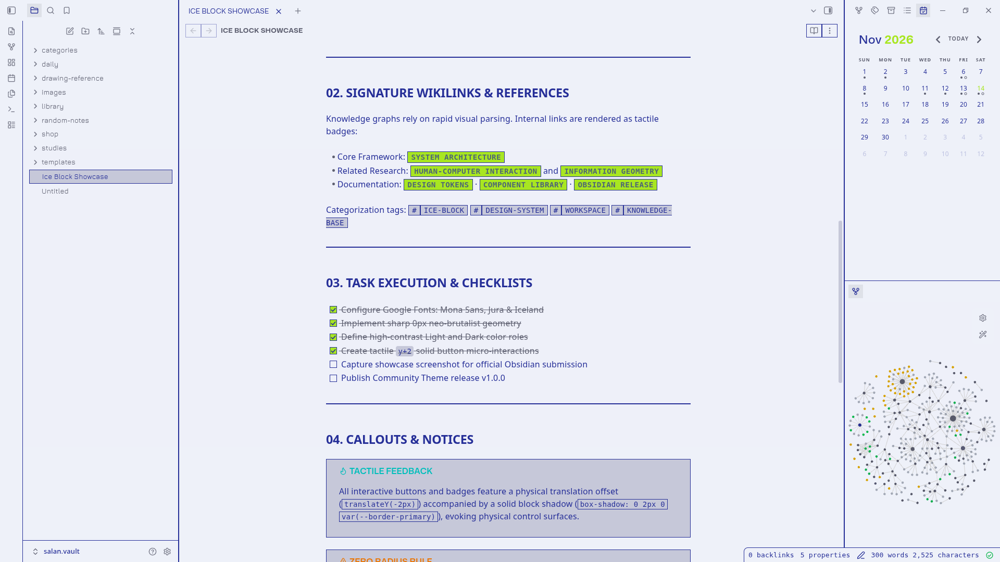

<div align="center">

# ★ ICE BLOCK
### A Sharp, Neo-Brutalist Theme for Obsidian

[](https://github.com/salanmato/obsidian-ice-block/releases)
[](https://obsidian.md)
[](LICENSE)
[](https://github.com/salanmato/obsidian-ice-block)

<br/>


</div>

---

## 🧊 Overview

**Ice Block** is a geometric, high-contrast neo-brutalist theme for [Obsidian](https://obsidian.md), inspired by industrial telemetry, avionics control panels, and clean technical documentation. 

Built with zero rounded corners, tactile micro-interactions, and signature high-contrast wikilink badges, it turns your digital notes into a sharp, legible knowledge workspace.

---

## ✨ Features

- **Sharp Neo-Brutalism**: Zero border-radius (`0px`) applied universally across all UI elements — buttons, note tabs, modal dialogs, search inputs, task checkboxes, and tags.
- **Signature Wikilink Badges**: Internal links (`[[Note]]`) stand out instantly as electric lime badges styled with the technical monospace font *Iceland*.
- **Tactile Button Physics**: Solid `0 2px 0` block shadows with subtle `translateY(-2px)` elevation on hover, giving controls a satisfying physical click feel.
- **Dual Contrast Modes**:
  - **Light Mode**: Cool Ice canvas (`#EFF1F9`), Royal Blue typography (`#212B99`), and Electric Lime accents (`#A9E71B`).
  - **Dark Mode**: Deep Slate background (`#5F6173`), Lavender body text (`#C7C9DA`), and glowing Lime highlights.
- **Curated Typography**:
  - **Headings**: `Mona Sans` — bold, architectural, left-aligned uppercase headers.
  - **Body & Interface**: `Jura` — technical, clean, legible modern sans.
  - **Code, Links & Metadata**: `Iceland` — crisp retro-futuristic monospace.

---

## 📸 Screenshots

### Note Editor & File Structure


### Palette, Geometry & Task Execution


### Callouts, Code Blocks & Technical Tables


---

## 🎨 Color Palette

| Swatch | Name | Hex | Usage |
| :---: | :--- | :--- | :--- |
|  | **Ice** | `#EFF1F9` | Light mode canvas & crisp dark mode highlights |
|  | **Royal Blue** | `#212B99` | Primary text, active states & structural borders |
|  | **Electric Lime** | `#A9E71B` | Signature wikilink badges, accents & active indicators |
|  | **Lavender** | `#C7C9DA` | Elevated cards, metadata surfaces & dark mode text |
|  | **Slate** | `#5F6173` | Dark mode canvas & light mode muted metadata |
|  | **Alert Red** | `#CC3C1C` | High-priority warnings & destructive actions |

---

## 🚀 Installation

### 1. Obsidian Community Themes (Official)
*(Available once approved in the Community Directory)*
1. In Obsidian, go to **Settings** (`Ctrl + ,` / `Cmd + ,`) $\rightarrow$ **Appearance**.
2. Under **Themes**, click **Manage**.
3. Search for **Ice Block** and click **Use**.

### 2. Via BRAT (Beta Reviewers Auto-update Tester)
1. Install the **BRAT** plugin from Community Plugins.
2. Go to **Settings** $\rightarrow$ **BRAT** $\rightarrow$ **Themes**.
3. Click **Add Beta Theme** and enter:
   ```text
   salanmato/obsidian-ice-block
   ```
4. Activate **Ice Block** in **Settings** $\rightarrow$ **Appearance** $\rightarrow$ **Themes**.

### 3. Manual Installation
1. Download `manifest.json` and `theme.css` from the latest [Release](https://github.com/salanmato/obsidian-ice-block/releases).
2. Open your vault folder and navigate to `.obsidian/themes/`.
3. Create a folder named `Ice Block` and place both files inside.
4. Reload Obsidian and select **Ice Block** in **Appearance**.

---

## 📄 License

Licensed under the [MIT License](LICENSE).  
Designed with care by **salanmato** © 2026.
