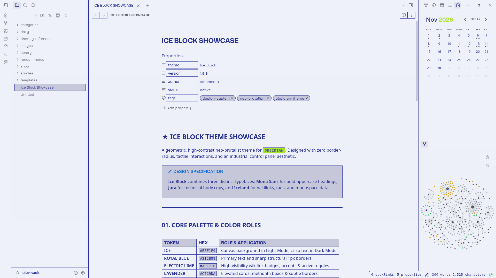
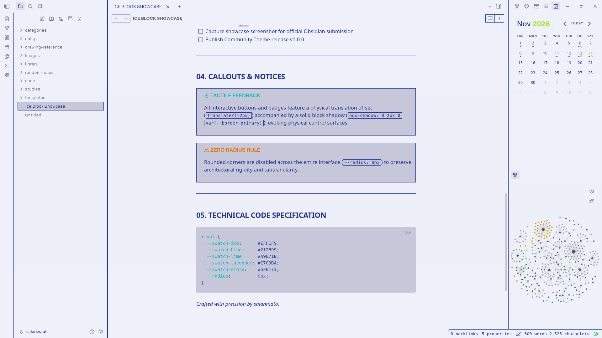

# Ice Block

A sharp, geometric, neo-brutalist theme for [Obsidian](https://obsidian.md) inspired by technical documentation, industrial control panels, and crisp retro-futuristic interfaces.

---

## Highlights

- **Neo-Brutalist Geometry**: Zero border-radius (`0px`) on all UI components — buttons, tabs, inputs, checkboxes, modais, and badges.
- **Signature Wikilink Badges**: Internal links (`[[Note]]`) rendered as high-contrast lime badges with Iceland mono typography.
- **Tactile Micro-Interactions**: Solid `0 2px 0` block shadows and subtle translateY offsets on buttons and hoverable elements.
- **Dual Mode Contrast**: Full support for both **Light Mode** (cool ice & deep royal blue) and **Dark Mode** (slate & electric lime).
- **Curated Typography**:
  - Headings: **Mona Sans** (Bold, left-aligned, uppercase)
  - Body & UI: **Jura** (Clean, technical sans)
  - Links, Tags, Monospace & Metadata: **Iceland** (Geometric monospace)

---

## Screenshots

---

## Palette

| Color | Hex | Role |
| :--- | :--- | :--- |
| **Ice** | `#EFF1F9` | Light mode canvas & dark mode text highlights |
| **Lavender** | `#C7C9DA` | Elevated cards, secondary borders & dark body text |
| **Slate** | `#5F6173` | Dark mode background & light mode muted text |
| **Royal Blue** | `#212B99` | Light mode primary text, borders & contrast elements |
| **Electric Lime** | `#A9E71B` | Accent highlights, wikilink badges, active toggles |
| **Alert Red** | `#CC3C1C` | Danger alerts & destructive actions |

---

## Installation

### Via Obsidian Community Themes (Recommended once approved)
1. In Obsidian, open **Settings** (`Ctrl + ,` / `Cmd + ,`).
2. Go to **Appearance** $\rightarrow$ **Themes** $\rightarrow$ **Manage**.
3. Search for **Ice Block** and click **Use**.

### Via BRAT (Beta Reviewers Auto-update Tester)
1. Install the **BRAT** community plugin in Obsidian.
2. Open BRAT settings and choose **Add Beta Theme**.
3. Enter `salanmato/obsidian-ice-block`.

### Manual Installation
1. Download `manifest.json` and `theme.css` from the latest [GitHub Release](https://github.com/salanmato/obsidian-ice-block/releases).
2. Inside your Obsidian vault, navigate to `.obsidian/themes/`.
3. Create a folder named `Ice Block` and paste both files into it.
4. Go to **Settings** $\rightarrow$ **Appearance** $\rightarrow$ **Themes** and select **Ice Block**.

---

## License

[MIT License](LICENSE) © 2026 salanmato
